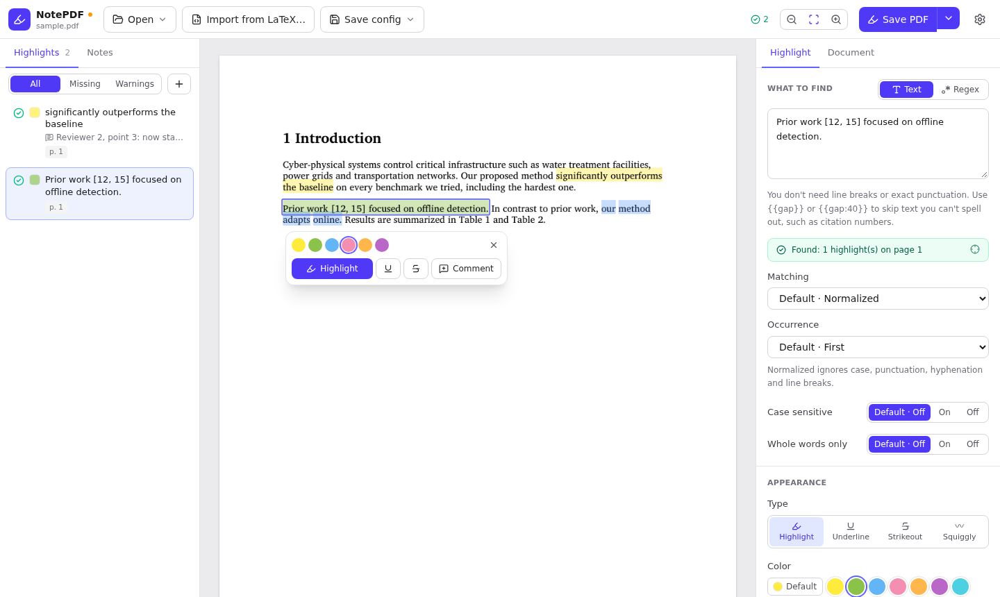
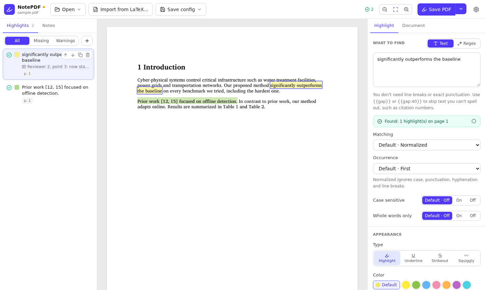
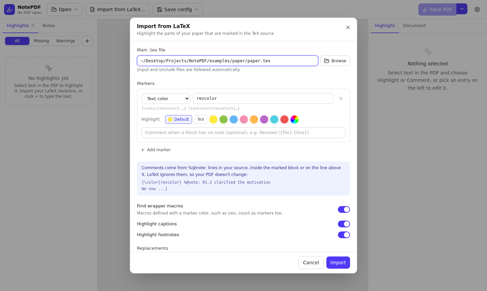
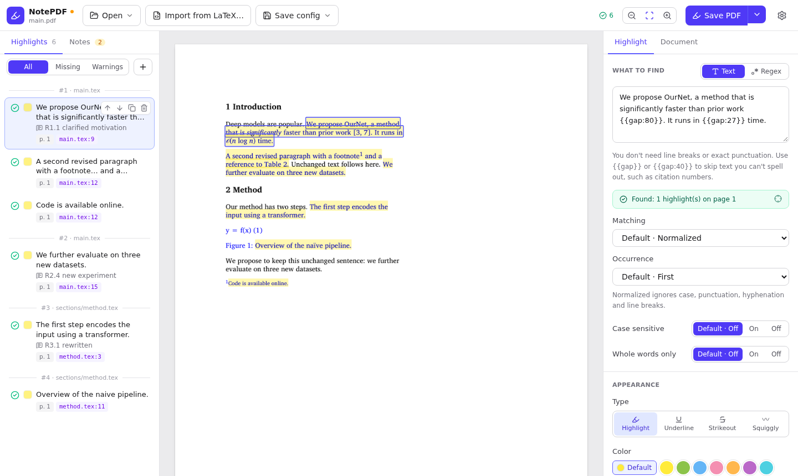

# NotePDF GUI and desktop app

NotePDF's graphical interface lets you highlight and comment a PDF by selecting text, as you
would in Edge or Acrobat. You can also review entries you typed or imported from LaTeX before
writing anything. Every highlight is an entry in a config file, so the same work can be saved as
YAML and re-applied later with `notepdf apply`.

The interface runs in your browser (`notepdf gui`), or as a desktop app that you build once and
install as a `.deb`.



- [Set up and start the GUI](#set-up-and-start-the-gui)
- [The window](#the-window)
- [Highlight by selecting text](#highlight-by-selecting-text)
- [Add an entry by typing it](#add-an-entry-by-typing-it)
- [Check and edit entries](#check-and-edit-entries)
- [Document settings](#document-settings)
- [Import highlights from LaTeX](#import-highlights-from-latex)
- [Save the PDF and the config](#save-the-pdf-and-the-config)
- [Opening files](#opening-files)
- [Settings and keyboard shortcuts](#settings-and-keyboard-shortcuts)
- [Build the desktop app](#build-the-desktop-app)
- [Developing the interface](#developing-the-interface)
- [Troubleshooting](#troubleshooting)

---

## Set up and start the GUI

You need Python 3.10 or newer with [uv](https://docs.astral.sh/uv/), and Node.js 22 or newer to
build the interface (the project is developed with Node 24).

```bash
cd NotePDF
uv sync --extra gui --extra fuzzy            # Python packages, including the GUI server
cd app && npm install && npm run build       # builds the interface into src/notepdf/gui/dist
cd ..
```

You only build the interface once, and again whenever `app/` changes. If you skip it, the browser
shows a page with the build command instead of the interface. The `fuzzy` extra is optional: it
enables approximate matching, which helps when a LaTeX source differs slightly from its PDF.

Start the GUI:

```bash
uv run notepdf gui                    # opens http://127.0.0.1:8766 in your browser
uv run notepdf gui paper.pdf          # ...and opens a PDF, a config (.yaml/.json) or a .tex file
```

| Option | Meaning |
|---|---|
| `--port 8766` | Port to listen on. Use another one if 8766 is taken. |
| `--no-browser` | Don't open a browser; just print the address. |
| `--host 127.0.0.1` | Address to listen on. Keep the default (see the note below). |

Under WSL, the GUI opens in your Windows browser. Stop the server with Ctrl+C.

> **Security:** the server can read and write any file your user can, so it listens on
> 127.0.0.1 only and rejects requests addressed to other host names. Don't use `--host` to make it
> reachable from other machines.

## The window



| Area | What it's for |
|---|---|
| **Top bar** | *Open* (PDF, config, new config, recent files), *Import from LaTeX…*, *Save config*, the match counts, zoom, *Save PDF*, and settings (⚙). An orange dot next to the name means the config has unsaved changes. |
| **Left: Highlights / Notes** | Every entry with its status, color, text, comment and pages. *Notes* lists messages from a LaTeX import, such as equations that couldn't be highlighted. |
| **Center: the PDF** | The pages with a live preview of every entry. Scroll to move; Ctrl+scroll or the zoom buttons to zoom; the frame button fits the page width. |
| **Right: Highlight / Document** | *Highlight* edits the selected entry. *Document* holds the defaults, the output file and the LaTeX source. |

The status icons in the list:

| Icon | Meaning |
|---|---|
| Green check | Found. The preview shows where. |
| Amber triangle | Found, with a warning (for example a fuzzy match, or only some sentences). |
| Red circle with "!" | Not found in this PDF. |
| Red circle with "×" | The entry is invalid (for example a broken regex); the error is shown under it. |
| Grey dashed circle | Still being checked. |

The filters above the list (*All*, *Missing*, *Warnings*) show only those entries. The counts in
the top bar do the same when clicked.

## Highlight by selecting text

1. **Drag across words** on a page, or **double-click** a single word. The selection turns blue
   and a toolbar appears under it.
2. Pick a **color** (the selected swatch has a ring).
3. Choose what to add:
   - **Highlight**, or the **underline** and **strikeout** buttons next to it, adds the entry at once.
   - **Comment** opens a text box. Type the comment and press **Enter** to add it; **Shift+Enter**
     starts a new line. **Esc** closes the toolbar without adding anything.

The new entry is selected and opens on the right, where you can change anything about it.

NotePDF targets the occurrence you selected. If the text appears only once in the document, the
entry is just the text. If it also appears elsewhere, NotePDF adds the page and, when needed, which
occurrence on that page it is (*Pages: 2*, *Occurrence: 2*), so saving highlights exactly what you
selected.

**Hover** over a highlight to read its comment. **Click** a highlight to select its entry, and
click an empty part of the page to deselect.

## Add an entry by typing it

Click **+** above the list and type the text into *What to find*. You can also type text that's
on many pages, or a pattern:

- **You don't need exact formatting.** The default *Normalized* matching ignores case,
  punctuation, hyphenation and line breaks. A sentence that wraps over three lines is still one
  entry.
- **Skip text you can't spell out** with `{{gap}}` (up to 60 characters) or `{{gap:N}}`, for
  example `prior work {{gap:15}} shows`, where the gap stands for citation numbers like
  `[12, 15]`.
- **Switch to *Regex*** for a Python regular expression, such as `Table\s+\d+`. Set *Occurrence* to
  *All* to highlight every match.

The status box under the text updates as you type ("Found: 2 highlight(s) on page 1, 3",
"Not found in this PDF.", or the warning). The crosshair button in it scrolls the PDF to the
match.

## Check and edit entries

Click an entry in the list to scroll the PDF to it and open it on the right. The
editor has these sections:

| Section | Settings |
|---|---|
| **What to find** | Text or regex; *Matching* (normalized, exact, fuzzy); *Occurrence* (first, all, or specific ones such as `2` or `1, 3`); *Case sensitive*; *Whole words only*. |
| **Appearance** | *Type* (highlight, underline, strikeout, squiggly); *Color* (eight swatches, or the rainbow circle for any color); *Opacity*. |
| **Comment** | The comment text; *Comment popup* (closed, open when the PDF opens, or none); *Author*; *Margin note icon*, which adds a sticky-note icon for viewers that don't show highlight comments, such as Chrome's. |
| **Where** | *Pages* to search (`3`, `2, 5-7`, `10-`; empty means all pages); *Text just before / after*, to tell apart identical text in different places. |
| **Advanced** | *Search in order*, *Fuzzy fallback*, *Sentence fallback*, *Continued on next page*, *Fuzzy threshold*, *Required*, *Expected text color*, *Group*, *Source*. |

**Default or own value.** Each setting uses the document default unless the entry sets its own.
*Default · Off* or the *Default* color chip means the entry follows the *Document* tab. Pick a
value to override it, or pick *Default* (or the ↺ next to *Opacity*) to go back.

Hover an entry in the list for **move up / move down / duplicate / delete**, or press **Delete**
to remove the selected entry. Order matters only for *Search in order*, where each entry is
searched for after the previous one's match.

## Document settings

The **Document** tab on the right applies to the whole PDF:

- **PDF**: the open file. *Choose…* opens another one.
- **Save annotated PDF to**: leave it empty to save `<name>.annotated.pdf` next to the original.
  Choose the original file itself to update it in place; NotePDF appends the annotations without
  rewriting the rest of the file.
- **Replace earlier NotePDF annotations**: on by default, so saving again replaces what NotePDF
  added last time instead of adding duplicates. Other people's annotations are never touched. A
  banner above the pages says when the open PDF already contains NotePDF annotations.
- **Defaults**: type, color, opacity, popup, author, subject, margin note icon, matching mode,
  occurrence and the advanced options, used by every entry that doesn't set its own.
- **LaTeX source**: after an import, *Re-import* refreshes the imported entries from the `.tex`
  files, and *Import settings…* changes the markers (see below).

## Import highlights from LaTeX

If you mark revised text in your paper, for example `{\color{revcolor} ...}`, NotePDF can turn
every marked passage into an entry.

1. Open the **compiled PDF** first, so you can see where the passages land.
2. Click **Import from LaTeX…** and fill in the dialog:

   

   - **Main .tex file**: your paper's main file. `\input` and `\include` files are followed.
   - **Markers**: what marks a revision. Each marker is a *Text color* (`revcolor` matches
     `{\color{revcolor} …}` and `\textcolor{revcolor}{…}`), a *Macro* (`rev` matches
     `\rev{…}`), or an *Environment* (`revised` matches `\begin{revised} … \end{revised}`). Add as
     many markers as you use.
   - **Highlight**: the color for that marker's passages. *Default* uses the document color; *TeX*
     uses the color defined with `\definecolor` in your preamble.
   - **Comment when a block has no note** (optional): a template such as
     `Revised ({file}:{line})`. `{n}`, `{file}`, `{line}` and `{marker}` are filled in.
   - **Find wrapper macros**: macros defined with a marker color, such as
     `\newcommand{\rev}[1]{{\color{revcolor}#1}}`, also count as markers.
   - **Highlight captions / footnotes**: include `\caption{…}` and `\footnote{…}` text.
   - **Replacements**: text for macros NotePDF can't expand, for example `\etal` → `et al.` when
     it's defined in a `.sty` file. Simple macros from your preamble are expanded automatically.
3. Click **Import**.



**Comments come from `%@note:` lines** in your source, placed inside the marked block or on the
line above it. LaTeX ignores them, so the PDF doesn't change:

```latex
{\color{revcolor} %@note: R1.2 clarified the motivation
We now explain why ...}

%@note: R2.3 new experiment
\rev{We further evaluate on three new datasets.}
```

Imported entries are grouped by block. Each shows the file and line it came from (`main.tex:9`),
and a block's comment goes on its first highlight. Display equations, tables and figure bodies
aren't highlighted; each one is listed in the **Notes** tab with its location, so you can add it
by hand if you want.

After you edit the paper and recompile, use **Document → Re-import**. It replaces the entries that
came from LaTeX and keeps the ones you added yourself.

## Save the PDF and the config

**Save PDF** writes the annotations to the output file and reports how many entries were found.
The message offers **Open**, which opens the file in your default PDF viewer (on WSL, the Windows
one), and **Show in folder**. The arrow next to *Save PDF* has **Save PDF as…** and the same two
actions for the last saved file.

The annotations are standard PDF highlights with appearance streams, so they display in Acrobat,
Edge, Firefox and other readers. Comments appear when you click or hover a highlight, and in the
reader's comment list.

**Save config** (Ctrl+S) writes everything (the PDF path, output, defaults and every entry) to a
`.yaml` file next to your work. Use **Save config as…** (Ctrl+Shift+S) for a new name. Paths are
stored relative to the config file when possible, so you can move them together. The same file
works on the command line:

```bash
uv run notepdf apply paper.notepdf.yaml
```

**Open → Open config…** loads a saved config and its PDF. A config that generates entries from
LaTeX on every run (one with a `tex:` section) is turned into editable entries when you open it,
and you can still re-import from the *Document* tab.

## Opening files

- **In the browser**, *Open* and *Browse* show NotePDF's own file dialog, because browsers don't
  give web pages file paths:
  - The shortcuts on the left are your home folder, your Windows Desktop, Documents and Downloads
    (under WSL), the `C:` drive and the whole computer.
  - Type or paste a path into the box at the top and press Enter. Windows paths such as
    `C:\Users\me\paper.pdf` work too.
  - Double-click a folder to open it and a file to choose it.
  - The dialog remembers the last folder for each kind of file.
- **In the desktop app**, *Open* uses the system's file dialog, and you can drag a PDF, config or
  `.tex` file onto the window to open it.
- **Recent files** are under *Open*, and on the start page.
- **Password-protected PDFs** ask for the password when you open them.

## Settings and keyboard shortcuts

**⚙ Settings** has the **language** (System, English or 简体中文) and the **theme** (System, Light or
Dark). Your choices and the recent-files list are stored in `~/.config/notepdf/gui.json`.

| Shortcut | Action |
|---|---|
| Ctrl+O | Open a PDF |
| Ctrl+S | Save the config |
| Ctrl+Shift+S | Save the config as… |
| Ctrl+scroll | Zoom |
| Delete / Backspace | Delete the selected entry (when you're not typing in a field) |
| Double-click a word | Select it |
| Enter / Shift+Enter | In the comment box: add the comment / new line |
| Esc | Close the selection toolbar or a dialog |

---

## Build the desktop app

The desktop app is the same interface in its own window, a [Tauri](https://tauri.app) shell in
`app/src-tauri`. When it starts, it runs the NotePDF backend from your checkout
(`.venv/bin/python -m notepdf gui --app` on a free local port). It stops the backend when you close
the window, and also if the app is killed. The Python code isn't copied into the package, so the
installed app always uses your checkout.

The build is set up for Debian and Ubuntu (a `.deb`), including WSL with WSLg.

### 1. Install the prerequisites

```bash
# System libraries Tauri needs
sudo apt update
sudo apt install libwebkit2gtk-4.1-dev build-essential curl wget file \
  libxdo-dev libssl-dev libayatana-appindicator3-dev librsvg2-dev

# Rust (stable, 1.80 or newer)
curl --proto '=https' --tlsv1.2 -sSf https://sh.rustup.rs | sh

# Node.js 22 or newer, and the Python environment (the app runs the backend from .venv)
uv sync --extra gui --extra fuzzy
```

rustup installs Rust into `~/.cargo/bin`. If `cargo` isn't found in a new terminal, add
`PATH=~/.cargo/bin:$PATH` in front of the build command below, or open a new login shell.

### 2. Build the package

```bash
cd app
npm install
npm run tauri build -- --bundles deb
```

This builds the interface, compiles the app in release mode (a few minutes the first time) and
writes the package to:

```
app/src-tauri/target/release/bundle/deb/NotePDF_0.1.0_amd64.deb
```

### 3. Install and start it

```bash
sudo apt install ./src-tauri/target/release/bundle/deb/NotePDF_0.1.0_amd64.deb
```

Start **NotePDF** from the applications menu, or from a terminal:

```bash
notepdf-app                  # the app
notepdf-app paper.pdf        # ...opening a file
```

The binary is called `notepdf-app` so it doesn't clash with the `notepdf` command-line tool.

### How the installed app finds NotePDF

- The app runs `<checkout>/.venv/bin/python`, where `<checkout>` is the folder it was built from.
  If you move the checkout, set `NOTEPDF_HOME=/new/path/to/NotePDF` or rebuild.
- **Changes to the Python code** apply the next time you open the app.
- **Changes in `app/`** (the interface or the Rust shell) need a rebuild and reinstall.
- If the backend can't start, the window shows why. Its output is in
  `<checkout>/app-backend.log`.

To uninstall: `sudo apt remove note-pdf`.

### Building without packaging

To compile only the app binary, without the `.deb` (for example to test a change):

```bash
cd app && npm run build                     # the binary embeds the built interface
cd src-tauri
cargo build --release --features tauri/custom-protocol
./target/release/notepdf-app
```

`--features tauri/custom-protocol` makes the binary use the built interface instead of the Vite
development server.

## Developing the interface

The interface lives in `app/` (Vue 3, TypeScript, Vite, Tailwind CSS). The server lives in
`src/notepdf/gui/` (FastAPI).

- **In a browser**, with reload on save:
  ```bash
  uv run notepdf gui --no-browser          # terminal 1: the backend on port 8766
  cd app && npm run dev                    # terminal 2: open http://localhost:1421
  ```
  The development server passes `/api` requests on to the backend.
- **In the desktop window:** `cd app && npm run tauri dev` starts the development server and a
  debug build of the app, which starts its own backend.
- **Checks:** `npm run build` type-checks the interface (vue-tsc) before building, and
  `uv run pytest` includes the server's API tests (`tests/test_gui_api.py`).
- **Translations** are in `app/src/i18n/en.json` and `zh-CN.json`. Both files must have the same
  keys. Write `{name}` for a value that's filled in; vue-i18n also treats `@` and `|` specially,
  so avoid them in messages.

## Troubleshooting

| Problem | Fix |
|---|---|
| The browser shows "The interface hasn't been built yet" | Run `cd app && npm install && npm run build`, then reload. |
| `error: the GUI needs extra packages` | Run `uv sync --extra gui`. |
| Port 8766 is already in use | `uv run notepdf gui --port 8770` |
| Settings say fuzzy matching is off | Run `uv sync --extra fuzzy`. |
| `npm run tauri build` panics with *Too many open files* | The system is out of inotify instances, which editors and other tools use. Raise the limit: `sudo sysctl fs.inotify.max_user_instances=512`. To keep it after a restart, also run `echo fs.inotify.max_user_instances=512 \| sudo tee /etc/sysctl.d/60-inotify.conf`. |
| `cargo: command not found` | Run the build as `PATH=~/.cargo/bin:$PATH npm run tauri build -- --bundles deb`. |
| The app says *Python environment not found* | Run `uv sync --extra gui` in the checkout, or set `NOTEPDF_HOME` to it. |
| The app says *The NotePDF backend stopped* | Read `<checkout>/app-backend.log`; the window shows its last lines. |
| `libEGL warning: DRI3 error` under WSL | Harmless. WSLg falls back to software rendering. |
| A highlight isn't found | Check the entry's status box. Try *Fuzzy* matching or *Sentence fallback*, add a `{{gap}}` for citations or math, or check *Pages*. A scanned PDF has no text to find; run OCR first. |
